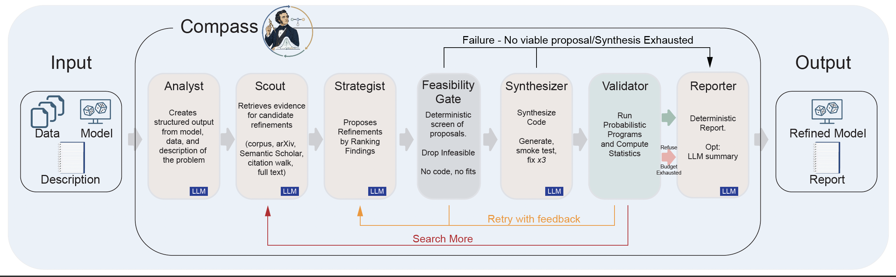

# COMPASS

[](https://doi.org/10.5281/zenodo.24212300)

**Statistically verified refinement of probabilistic programs with literature-grounded agents and a deterministic MCMC verifier.**

COMPASS is a verifier-first system for refining Bayesian models. LLM agents diagnose model weaknesses, search the statistical literature, propose evidence-grounded refinements, and synthesize candidate probabilistic programs. Initially meant for Stan and Numpyro, its current implementation is numpyro heavy. A separate deterministic verifier fits the baseline and candidate models with NUTS and decides whether a proposed refinement is supported by the data.

The central design principle is the separation of the proposal of revisions and the acceptance of them by a statistical
referee. In simple terms, **agents propose and statistical evidence decides.**



## What COMPASS does

COMPASS takes three inputs:

* a dataset,
* a working Bayesian model implemented as a NumPyro program, and
* a plain-language description of the observed *symptoms* of model misspecification, not the desired fix.

Four LLM-based agents then act as methodology-aware collaborators:

* **Analyst**: diagnoses potential weaknesses in the current model.
* **Scout**: searches the statistical literature for relevant methods.
* **Strategist**: converts the diagnosis and retrieved evidence into ranked, falsifiable refinement proposals.
* **Synthesizer**: implements candidate NumPyro programs.

A **reporter** assembles the results into a complete run report. Reporting is deterministic by default, with an optional LLM-generated narrative available through `report_llm=`.

Model acceptance is handled separately by a deterministic **verifier**, not by an LLM. The verifier fits both the baseline and candidate models with NUTS and evaluates a fixed statistical acceptance rule based on:

* posterior-computation diagnostics,
* cross-validated predictive improvement,
* posterior predictive checks, and
* predictive-comparison reliability diagnostics.

A refinement is accepted only when it satisfies these predefined statistical criteria. If no candidate clears the acceptance threshold, COMPASS retains the original model and reports that no supported refinement was found.

Rejections are also first-class outputs. Each failed validation returns specific diagnostic reasons that can inform the next round of proposals. This separation between **proposal** and **acceptance** is the core design principle of COMPASS: LLM agents can generate and implement candidate refinements, but they do not decide whether those refinements are supported by the data.


## Key properties

- **The verifier has no LLM in it.** Acceptance is a deterministic predicate over MCMC fits
  (gates G, S, P, R; see [`AGENT_GUIDE.md`](https://github.com/M-Lab-Repo/compass/blob/main/AGENT_GUIDE.md)
  for the full contract).
- **Reliability-gated comparison.** When importance-sampled LOO is untrustworthy (Pareto
  k̂ > 0.7), the comparison auto-escalates to an exact-refit instrument, unit-level K-fold CV
  when per-unit structure is derivable, otherwise exact refits of the influential points
  (`reloo`), and the instrument itself must pass fold-level convergence gates (R-hat) before
  any verdict is issued. Deeper instruments (up to leave-one-unit-out) are available explicitly
  via `cv_spec`. An infinite Pareto k̂ (what arviz returns for degenerate importance weights,
  for example from a masked observation) is treated as unreliable, never as a pass: it
  escalates like k̂ > 0.7 does and, when neither exact-refit rung re-adjudicates the comparison,
  refuses with `PSIS unreliable: refined-model Pareto-k-hat is inf (degenerate importance
  weights)`. A NaN k̂ means the tail could not be estimated and does not gate; the repair
  clause, which needs positive evidence of a reliable comparison, is barred by both.
- **Observation-set checks.** The two fits must score the same observed data, and the check
  is comparative: the candidate's observed sites are compared with the baseline's. A mask
  that both programs share (the data's own missingness, declared the same way on both sides)
  is allowed. A candidate that masks part of the observations on its own (`numpyro.handlers.mask`,
  `Distribution.mask`, the `obs_mask=` keyword of `numpyro.sample`) or scales an observed
  site (`handlers.scale`) when the baseline does not, that cannot be traced on the data, whose
  observed variables, shapes or values differ from the baseline's (values compared at float32
  tolerance; one renamed observed site is allowed when its shape and values are identical),
  whose pointwise log-likelihood is degenerate where the baseline's is not (a column constant
  across draws or non-finite, the signature of a masked or clamped point), or whose likelihood
  parameters depend on the observed response when the baseline's do not (a two-faced
  likelihood that lets points opt out of the comparison without a mask) is refused before any
  comparison is made, with a failure reason that starts `model comparison refused:` and never
  an ELPD number; no escalation and no repair clause runs on it. No candidate can "improve"
  by changing what is being predicted.
- **Repair-equivalence clause.** A candidate that fixes computation while provably leaving
  predictions unchanged (TOST within ±4 nats) can be certified as a *repair* rather than
  rejected for not "improving".
- **Honest nulls.** When nothing clears the bar, the run terminates with no accepted
  refinement and the original model deploys unchanged; the report says so plainly (the
  terminal status is `failed`, i.e. "no validated improvement", which for an adequate model is
  the correct answer).
- **Literature grounding.** Proposals cite retrieved papers (local corpus + optional live
  arXiv / Semantic Scholar), but provenance never enters the acceptance predicate.

## Install

The repository is public from release 0.3.0 at <https://github.com/M-Lab-Repo/compass>. The distribution
name is `compass-refine` (the import name is `compass`); `pip install compass-refine` will
work once published on PyPI; the name is reserved for a later upload. Until then, install
from GitHub or from a clone:

```bash
# from GitHub
pip install git+https://github.com/M-Lab-Repo/compass.git
# extras from GitHub use the direct-reference form
pip install 'compass-refine[providers] @ git+https://github.com/M-Lab-Repo/compass.git'

# from a clone
git clone https://github.com/M-Lab-Repo/compass.git && cd compass
pip install -e '.[dev]'          # the package plus pytest and ruff, to run the tests
pip install -e '.[providers]'    # plus the OpenAI and Google clients for get_llm(provider="openai" | "google")
pip install -e '.[figures]'      # plus matplotlib, Pillow and pypdf for the figure code under figures/ (drawing; the run and score steps need only the package)
```

Python ≥ 3.10. Heavy dependencies: `jax`, `numpyro`, `arviz`, `langgraph`, `langchain-anthropic`.

**Tested environment:** Python 3.10.9, numpyro 0.19.0, jax 0.6.2 (CPU), arviz 0.23.4,
langgraph 1.2.x, langchain-core 1.x; `constraints.txt` pins that environment exactly
(`pip install -c constraints.txt -e .`). NumPyro >= 0.21 requires Python >= 3.11 (0.20.0 is
the last release for Python 3.10), so on Python 3.10 pip resolves to NumPyro 0.20.0 or
earlier; either works with COMPASS.

Set the API key of the provider you use in the environment or in a `.env` file in the current
working directory or one of its parents (loaded with `python-dotenv`): `ANTHROPIC_API_KEY`
for the default provider, `OPENAI_API_KEY` for OpenAI, `GOOGLE_API_KEY` for Google
(`GEMINI_API_KEY` is accepted as an alias). The agents need a key; the verifier alone does not.
Optional: `BAYES_REFINE_PROVIDER` selects the provider when no `provider` argument is given, and
`BAYES_REFINE_MODEL`, `BAYES_REFINE_MODEL_OPENAI`, `BAYES_REFINE_MODEL_GOOGLE` override each
provider's default model (see [Choosing the model provider](#choosing-the-model-provider-and-metering-usage)).

## Running the tests

One command runs everything. No test needs an API key or network access, and the suite
neutralises any key found in the environment or a `.env` file. Set `JAX_PLATFORMS=cpu` so that
JAX does not look for an accelerator.

```bash
pip install -e '.[dev,figures]'
JAX_PLATFORMS=cpu python -m pytest tests -m "not slow"   # the package and the figure code
ruff check .                                             # lint; configuration in pyproject.toml
```

`tests/` holds two groups. The package tests at its top level cover the API surface, the graph
flags, the providers, structured output, usage metering, the sync tool, the provenance checker,
the examples and the ported research suites (verifier gates, crossval, repair clause, strategist,
synthesizer, retrieval, judge). `tests/figures/` tests the figure code under `figures/` and needs
the `figures` extra (matplotlib, Pillow, pypdf); the directory is collected only when the extra
is installed (`tests/conftest.py`), so `pytest tests` passes on a plain `pip install -e '.[dev]'`
and runs everything after the install line above. The same two steps, the tests and
`ruff check .`, run in GitHub Actions on Python 3.10, 3.11 and 3.12
(`.github/workflows/tests.yml`).

The `slow` marker selects the tests that sample or compile. In the package suite these are the
twelve tests of the verifier round trip of `test_smoke.py`, the `--fast` run of
`examples/verifier_only.py` (`test_examples.py`), four in `test_crossval.py`, four in
`test_synthesizer.py` (two real smoke-test subprocesses and two CmdStan compiles, which skip
without the `stan` extra), and one each in `test_validator_gates.py` and
`test_repair_clause.py`; `JAX_PLATFORMS=cpu python -m pytest tests -m slow` takes about two
minutes on one CPU core.

No test ships data. Two environment variables point the tests at the data archive (see
"Reproducing the paper's figures and experiments"), and the tests that need them skip
otherwise: `COMPASS_ARMS_DIR`, the `arms/` directory of the benchmark records, makes the tests of
`tests/figures/test_figure{2,3,4}.py` that read the records run instead of skipping, and
`COMPASS_DATA_DIR`, the `datasets/` directory, points the real-data loaders of `figures/bench/`
at the vendored datasets. One figure test, the overlay check of the Figure 2 sheet in
`test_figure2.py`, also needs the optional `pymupdf` and skips without it. The tests that compare
this tree with the research checkout, `tests/figures/test_provenance.py`, skip unless one is found
in the parent directory of this repository.

## Sixty-second example

The full pipeline calls a language model, so this example needs `ANTHROPIC_API_KEY` in the
environment or a `.env` file (or another provider's key together with `llm=get_llm(provider=...)`,
below); `examples/quickstart.py` is a seeded, cached version of this example (a fixed random
seed and a `cache_dir`), ready to run. Runtime: several minutes, most of it MCMC.

```python
import numpy as np
from compass import run_refinement

data = {"y": np.random.negative_binomial(2, 0.3, size=200),  # overdispersed counts
        "n": 200}  # sizes are data, never hardcoded (the synthesizer smoke-tests on dummy shapes)

MODEL = '''
def model(n=None, y=None):
    lam = numpyro.sample("lam", dist.Exponential(0.1))
    with numpyro.plate("obs", n):
        numpyro.sample("y", dist.Poisson(lam), obs=y)
'''

final = run_refinement(
    problem_description="Count outcome with sample variance far above the mean; "
                        "occasional large values. The Poisson baseline may be too rigid.",
    model_code=MODEL,
    data=data,
    max_iterations=2,
)
print(final["report"])
```

The same run with OpenAI models for every agent (needs `OPENAI_API_KEY` and the `providers` extra):

```python
from compass import get_llm
final = run_refinement(..., llm=get_llm(provider="openai"))
```

Verifier-only (no LLM, no API key): adjudicate a candidate you already have. With `data` and
`MODEL` from above as the baseline:

```python
from compass import run_full_validation

original_src = MODEL
candidate_src = '''
def model(n=None, y=None):
    mu = numpyro.sample("mu", dist.Exponential(0.1))
    phi = numpyro.sample("phi", dist.HalfNormal(5.0))
    with numpyro.plate("obs", n):
        numpyro.sample("y", dist.NegativeBinomial2(mu, phi), obs=y)
'''
result = run_full_validation(candidate_src, original_src, data, seed=0,
                             num_warmup=300, num_samples=600, num_chains=2)
print(result.failure_reasons or "accepted")
```

The complete script is `examples/verifier_only.py`: it prints the verdict, the failure
reasons, `elpd_diff ± se` and the wall time. On one CPU core (Python 3.10.9, jax 0.6.2) it
printed `verdict: accepted (confidence HIGH)` and `elpd_diff: -112.99 +/- 23.41` after 11 s of
sampling (14 s in all, JAX import included). `--fast` halves the budget for a quick check of
the installation; at that budget the baseline's ESS falls below 400 and the verifier refuses to
certify the comparison (`original-model fit unreliable (comparison baseline): ESS 292`), which
is the budget being judged, not the candidate, which is the reason `fast` numbers are never verdicts.

## Configuration reference

All options, by the layer they belong to. Anything not listed here is internal.

### `run_refinement(...)`: the one-call pipeline

| Option | Default | Meaning |
|---|---|---|
| `problem_description` | required | Observable symptoms, never the fix |
| `dataset_summary` | `""` | Auto-computed from `data` (pandas) when empty |
| `model_code` | `""` | Source of the baseline `model` function |
| `framework` | `"numpyro"` | `"stan"` exists behind the `[stan]` extra, NumPyro is the supported path |
| `data` | `None` | The dataset dict (arrays + size scalars) |
| `max_iterations` | `3` | Propose→synthesize→validate rounds |
| `thread_id`, `recursion_limit` | auto / `50` | LangGraph plumbing |
| `**graph_kwargs` | none | Everything below is forwarded to `build_refinement_graph` |

### `build_refinement_graph(...)`: the pipeline's knobs

| Option | Default | Meaning |
|---|---|---|
| `llm` | `get_llm()` | Shared model for all agents |
| `analyst_llm` / `scout_llm` / `strategist_llm` / `synthesizer_llm` | `llm` | Per-agent overrides (mix model tiers, or inject `FixtureLLM` in tests) |
| `report_llm` | `None` | Reporter narrative LLM; deterministic report when unset |
| `scout_kwargs` | `{}` | See scout options below |
| `synthesizer_kwargs` | `{}` | `max_attempts` (default 3): synthesis retry budget per candidate; `data`: smoke-test candidates on these real arrays instead of dummy data derived from the recorded shapes; `guard_replicate_sites`: add the NumPyro site guard to the synthesizer prompts; `validator`: inject a `(code, data_shapes) -> verdict dict` check in place of the NumPyro smoke test |
| `validator_kwargs` | `{}` | See validator options below |
| `strategist_directive` | `""` | Extra standing instruction appended to the strategist prompt |
| `hint_level` | `"structure+ladder"` | Diagnostic-hint verbosity fed back to the strategist: `"none"` \| `"structure"` \| `"structure+ladder"` |
| `verdict_only` | `False` | Benchmark arm. Redacts the verifier's feedback to the proposer: after a refused candidate the `feedback_history` entry carries the iteration number and `verdict_only: True` with every other field empty (no failure reasons, LOO or PPC numbers, failed predictions, diagnostic hints or proposal names, so the deterministic DO-NOT-PROPOSE ban bans nothing). The validator still runs in full and `candidate_history` keeps every verdict |
| `smoke_on_data` | `False` | With `data` given (`run_refinement` passes its `data` through), the synthesizer's smoke test runs candidates on the real arrays instead of dummy data derived from the recorded shapes; dummies turn integer count and index columns into negative floats, which fails every candidate that uses them semantically. Forwarded as `synthesizer_kwargs["data"]`; an explicit entry there wins |
| `guard_replicate_sites` | `False` | The synthesizer's prompts carry the NumPyro site guard (no unobserved replicate or discrete sample sites, which NUTS cannot sample) and its fix prompt gets a targeted hint on such errors. Forwarded as `synthesizer_kwargs["guard_replicate_sites"]`; an explicit entry there wins |
| `checkpointer` / `interrupt_before` | `None` | LangGraph checkpointing / human-in-the-loop pause points |

Every validated candidate is appended to `WorkflowState.candidate_history` (iteration, source,
proposal names and rationale, `passed`, the `ValidationResult`), independently of `verdict_only`.

### `get_llm(...)`, the agents' chat model

| Option | Default | Meaning |
|---|---|---|
| `provider` | `None` | `"anthropic"`, `"openai"` or `"google"`; `None` means `BAYES_REFINE_PROVIDER`, else `"anthropic"` |
| `model` | `None` | Model identifier; `None` means the provider's model variable (`BAYES_REFINE_MODEL`, `BAYES_REFINE_MODEL_OPENAI`, `BAYES_REFINE_MODEL_GOOGLE`), else the provider default (`claude-sonnet-4-6`, `gpt-5`, `gemini-3.1-pro-preview`) |
| `temperature` | `0.0` | Sampling temperature. Not sent to OpenAI reasoning models (the o-series and `gpt-5*` ids other than the `gpt-5-chat*` chat models), which reject it |
| `max_tokens` | `8192` | Output cap. Raised to at least 32768 for OpenAI reasoning models, whose reasoning tokens count against it |
| `timeout` | `120.0` | Seconds before a stalled request fails instead of blocking the pipeline |
| `max_retries` | `2` | Client-side retries of transient errors and timeouts |

On OpenAI, `with_structured_output` uses function calling (`method="function_calling"`,
`strict=False`) rather than the strict JSON-schema response format, which rejects the project's
nested pydantic schemas; callers that pass `method` or `strict` explicitly win. A missing key
raises `RuntimeError` naming the variable; a missing client package raises `RuntimeError` naming
the package (`langchain-openai`, `langchain-google-genai`; both are in the `providers` extra).

### Validator options (`validator_kwargs` for the pipeline node, `run_full_validation` for direct calls)

| Option | Default | Meaning |
|---|---|---|
| `cache_dir` | `None` | Content-addressed fit cache (code, data, budget, seed); set it |
| `seed` | `0` | Harness seed for every fit |
| `fast` | `False` | Tiny budgets for smoke tests; never a verdict |
| `num_warmup` / `num_samples` / `num_chains` | spec defaults | MCMC budget (`run_full_validation` only; in the pipeline use a `validation_fn` closure, see `skill/scripts/run_refinement.py`) |
| `target_accept` | `0.8` | NUTS target acceptance (`run_full_validation` only) |
| `cv_spec` | `None` | Explicit cross-validated S gate in place of PSIS-LOO, as a dict `{"spec": CVSpec(...), "scheme": "kfold", "K": 5, ...}`. `"spec"` is a `compass.crossval.CVSpec` declaring the exchangeable unit (`per_unit_keys`, `local_latents`, `obs_site`, `obs_kwarg`, `unit_size_keys`, `shared_keys`, `unit_axis`, `per_unit_axes`, `plate`); every other key is forwarded to `crossval_compare`: `scheme` (`"kfold"`, `"split"` or `"entry_mask"`), `K` (folds; capped at the number of units, so `K` = the unit count is exact leave-one-unit-out), `split_frac` (held-out fraction of the `"split"` scheme), `budget` (a `(warmup, samples, chains)` triple for the fold fits, default `(400, 800, 2)`), `s_use` and `r_prior` (posterior draws and prior draws used when marginalising the local latents of a held-out unit). Required to reach deep instruments such as leave-one-unit-out; worked example below. In the pipeline, applied only with the default `run_full_validation` |
| `auto_cv` | `True` | Allow the one-step automatic escalation (PSIS → unit K-fold or reloo) on a Pareto-k̂ failure. In the pipeline, applied only with the default `run_full_validation` |
| `repair_clause` | `True` | Enable the repair-equivalence verdict. In the pipeline, applied only with the default `run_full_validation` |
| `compute_heldout` | `False` | Pipeline only (not an argument of `run_full_validation`). After a candidate passes, score a descriptive held-out split on that winner and attach it as `result.heldout`; it never changes acceptance, and it is marked unavailable when the S gate was already cross-validated (`cv_spec` set or an escalated instrument used). Requires the default `run_full_validation`, NumPyro and real `data` |
| `validation_fn` | `None` | Full replacement of the validation call (the budget-override hook) |

A worked `cv_spec`: a hierarchical model of `J` schools whose per-school effect `theta` is a
local latent, certified by exact leave-one-school-out (`K` equal to the number of units). Each
fold refits both models without one school and scores that school with its latent marginalised,
so the cost is `J` refits per side; set `cache_dir` so that retries never resample a fit.

```python
from compass import run_full_validation
from compass.crossval import CVSpec

# data = {"y": (J,) array, "sigma": (J,) array, "J": J}; the model reads y, sigma and J
spec = CVSpec(per_unit_keys=["y", "sigma"],   # arrays sliced along the school axis when folding
              local_latents=["theta"],         # per-school sites, marginalised for a held-out school
              obs_site="y", unit_size_keys=["J"], plate="school")
res = run_full_validation(candidate_src, original_src, data, seed=0, cache_dir=".compass_cache",
                          cv_spec={"spec": spec, "scheme": "kfold", "K": data["J"]})
print(res.s_gate, res.elpd_diff, res.elpd_diff_se, res.failure_reasons)
```

A custom `validation_fn` is called as `fn(refined_code, original_code, data, framework=, fast=,
cache_dir=, seed=, proposals=)` and nothing else: `cv_spec`, `auto_cv`, `repair_clause` and
`compute_heldout` are not forwarded to it, so a replacement that wants them must pass them to
`run_full_validation` itself. Accept `**kwargs` so that future keywords do not break the call
(`skill/scripts/run_refinement.py` shows the pattern).

### Scout options (`scout_kwargs`)

| Option | Default | Meaning |
|---|---|---|
| `live` | `False` | Turn on live retrieval (arXiv + Semantic Scholar) on top of the local corpus |
| `corpus` | `None` | Curated paper list for the local index; falls back to the bundled 15-paper test fixture (with a logged warning) |
| `max_findings` | `5` | PaperFindings forwarded to the strategist |
| `score_drop` / `score_fetch` | `6` / `8` | Applicability-score thresholds: below `score_drop` a paper is dropped; at `score_fetch`+ its method excerpt is attached |
| `min_findings` | `0` | Trigger the query-decomposition fallback when fewer survive |
| `paper_finder_enabled` | `False` | Extra Semantic Scholar paper-finder channel (needs an API key, see below) |
| `embedder` / `store` / `applicability` / `extraction` / `paper_finder` | `None` | Dependency-injection points (custom embeddings, vector store, scoring) |

Each retrieved paper is scored by a structured applicability call to the scout's LLM. When the
reply does not fit the schema after the structured-output retries (see
[below](#choosing-the-model-provider-and-metering-usage)), the paper is treated as not applicable
(score 0, every boolean false) instead of failing the run; the parsing error is kept in the
verdict's `effort_to_improvement` field.

### Environment variables

| Variable | Needed for | Notes |
|---|---|---|
| `ANTHROPIC_API_KEY` | the default provider's agents | Verifier-only runs need none |
| `OPENAI_API_KEY` | `provider="openai"` | Needs the `providers` extra |
| `GOOGLE_API_KEY` | `provider="google"` | `GEMINI_API_KEY` is accepted as an alias (copied into `GOOGLE_API_KEY` when that is unset); needs the `providers` extra |
| `BAYES_REFINE_PROVIDER` | optional | Provider used when `get_llm` receives no `provider` argument: `anthropic`, `openai` or `google` |
| `BAYES_REFINE_MODEL` | optional | Override the default Anthropic model |
| `BAYES_REFINE_MODEL_OPENAI` / `BAYES_REFINE_MODEL_GOOGLE` | optional | Override the default OpenAI / Google model |
| `S2_API_KEY` | optional, live scout | Semantic Scholar Graph API key, sent as the `x-api-key` header on every Semantic Scholar channel (search, citations, paper finder) |
| `ASTA_API_KEY` | optional, live scout | Alternative Semantic Scholar (Asta) key; used for every Semantic Scholar channel when `S2_API_KEY` is absent |

Every variable may also be set in a `.env` file in the current working directory or one of its
parents (loaded with `python-dotenv` when `get_llm` runs, through `find_dotenv(usecwd=True)`:
the search starts at the working directory, never at the installed package's own directory).

## Live scout: keys and setup

`scout_kwargs={"live": True}` enables two live channels. **arXiv needs no key.** Semantic
Scholar works keyless on the shared public rate limit; an API key gives you a dedicated limit,
and the optional **paper-finder** channel (`paper_finder_enabled=True`) stays off entirely
unless a key is present. All live channels are throttled (one call per 2.5 s to Semantic
Scholar, per 3 s to arXiv), retried once on a 429 (after the server's numeric `Retry-After`
when it is within the 30 s cap, else after a fixed backoff; a `Retry-After` beyond the cap skips
the retry) and degrade to empty results rather than failing the run.

1. Request a free Semantic Scholar key at <https://www.semanticscholar.org/product/api>
   (or use an Asta key if you have one).
2. Put the keys in a `.env` file in the current working directory or one of its parents
   (loaded with `python-dotenv`), or export them:

```bash
# .env
ANTHROPIC_API_KEY=sk-ant-...
OPENAI_API_KEY=sk-...           # only for provider="openai"
GOOGLE_API_KEY=...              # only for provider="google" (GEMINI_API_KEY also works)
BAYES_REFINE_PROVIDER=anthropic # optional: default provider when get_llm() gets none
S2_API_KEY=...          # optional: dedicated Semantic Scholar rate limit
ASTA_API_KEY=...        # optional alternative, used for every Semantic Scholar channel when S2_API_KEY is absent
```

```python
final = run_refinement(..., scout_kwargs={"live": True})                      # arXiv + S2
final = run_refinement(..., scout_kwargs={"live": True, "corpus": my_papers}) # + your corpus
```

## Choosing the model provider and metering usage

`get_llm` builds the chat model that every agent shares, or a per-agent override. Precedence
for the provider: the `provider` argument, then `BAYES_REFINE_PROVIDER`, then `anthropic`. For
the model identifier: the `model` argument, then the provider's model variable
(`BAYES_REFINE_MODEL`, `BAYES_REFINE_MODEL_OPENAI`, `BAYES_REFINE_MODEL_GOOGLE`), then the
provider default (`claude-sonnet-4-6`, `gpt-5`, `gemini-3.1-pro-preview`). The OpenAI and
Google clients come from the `providers` extra.

```python
from compass import get_llm, run_refinement

final = run_refinement(..., llm=get_llm(provider="google"))                             # every agent
final = run_refinement(..., synthesizer_llm=get_llm(provider="openai", model="gpt-5"))  # one agent
```

The verifier never calls an LLM. The provider therefore affects the analyst, scout, strategist
and synthesizer (and the optional `report_llm` narrative), plus the evaluation-only judges in
`compass.judge`, which read code and are never wired into acceptance. The acceptance predicate
and its gates are identical under every provider.

**Structured output and its retry contract.** Every agent call asks the model for a reply typed
by a pydantic schema. A reply that does not fit (missing or mistyped fields, a list serialized
as a string, no tool call at all) is retried `STRUCTURED_RETRIES` (2) more times, each time with
a schema reminder appended to the prompt. Once the retries are spent:

- the analyst and the strategist raise `StructuredOutputError`, which propagates out of
  `run_refinement` (the message names the schema and the last parsing error);
- the synthesizer gives up on the current candidate: the failure is appended to `error_log` as a
  synthesis failure and `refined_model_code` is left empty, so the graph skips validation and
  goes straight to the report (the run ends there); that candidate was never adjudicated;
- the scout treats the paper whose applicability reply could not be parsed as not applicable
  (score 0) and continues.

These are plumbing failures of the provider and should be reported as such, never as evidence
about the model or the proposal.

**An all-rejected round.** After the strategist's reply is parsed, a deterministic
post-validation drops any proposal whose name matches a technique already recorded as failed in
`feedback_history` (the DO-NOT-PROPOSE ban), whose `change_type` is invalid, or that cites no
finding while findings exist. When nothing survives, the node returns an empty bundle instead
of raising: `error_log` gets a line starting `strategist: post-validation rejected every
proposal` (`compass.agents.strategist.EMPTY_BUNDLE_LOG_PREFIX`), the feasibility gate books a
failed iteration whose feedback entry names no technique, and the graph retries the strategist
within `max_iterations` or goes to the report. The DO-NOT-PROPOSE bullet the next round sees
names every banned technique of each entry (`tried` and all of `tried_all`), the same list the
ban enforces.

**Metering.** `track_usage` counts every chat-model call made inside its block, on any provider
and any model built anywhere (including the judges and a `FixtureLLM(usage=(i, o))` test
double), with no handler attached to the models themselves:

```python
from compass import run_refinement, track_usage

with track_usage("refinement") as usage:
    final = run_refinement(...)
print(usage.snapshot())
# {"calls": ..., "input_tokens": ..., "output_tokens": ..., "total_tokens": ...,
#  "seconds": ..., "calls_without_usage": ..., "errors": ..., "by_model": {model_id: {...}}}
```

`by_model` is keyed by the requested model identifier. Nested blocks count toward their
enclosing ones exactly once. `UsageTracker` is the handler class behind the context manager,
for callers that want to hold the tracker directly.

## Security

`run_refinement` executes Python written by a language model on your machine. The
synthesizer's smoke test runs each candidate in a subprocess with a scrubbed environment: the
interpreter runs in isolated mode (`python -I`) with a short allowlist built by
`compass.agents.synthesizer.smoke_test_env` (`PATH`, `HOME`, the locale, `TMPDIR`, library
paths, the JAX/XLA/CUDA/OpenMP thread knobs and the Windows start-up variables; see
`smoke_test_env` for the exact names) and every `*_API_KEY`, `*_TOKEN` and `BAYES_REFINE_*`
variable is dropped whatever else matches (`PYTHONPATH` is not passed through). The validator
then fits the candidate in-process with NUTS (an `exec` of the source in the calling process).
Neither is a sandbox: the subprocess still has the host's filesystem and network, and the
in-process fit has every privilege of the Python process that called it. Note that `-I` also
ignores `PYTHON*` variables and the user site-packages, so NumPyro and JAX must be installed in
the interpreter's own environment (a venv or conda environment, not `pip install --user`):
the synthesizer probes the interpreter before the first smoke test and raises
`EnvironmentError` when `numpy`, `jax` or `numpyro` is not importable under `-I`, instead of
failing every candidate with an import error. Treat a run the way you would treat
running code from a pull request you have not read:

- run COMPASS in a container or VM, especially with live retrieval (`scout_kwargs={"live": True}`)
  or a corpus you did not curate, since retrieved text reaches the prompts that write the code;
- keep nothing in the environment beyond the provider key (and, if you use them, the scout
  keys); the fit cache and the `.env` file should hold nothing else of value;
- read `final["refined_model_code"]` before you deploy it.

The verifier alone (`run_full_validation`, `skill/scripts/verify_candidate.py`) executes only
the two programs you pass it.

## Reproducing the paper's figures and experiments

Everything that reproduces the paper's figures is under `figures/`, documented in
[`figures/README.md`](https://github.com/M-Lab-Repo/compass/blob/main/figures/README.md): the
per-panel scripts of Figure 2 (`figures/figure2/`), Figure 3 (`figures/figure3/`) and the cost
figure, Supplementary Fig. 1 (`figures/figure4/`), each panel with a run, a score and a create
step, copied from the research tree by `tools/sync_figures.py` with the imports of the pipeline
rewritten to the installed package (`figures/provenance.json` is their manifest); the four
benchmark modules the run and score steps import (`figures/bench/`); the driver
`figures/render.py`, which writes the eleven vector PDFs of the manuscript from the committed
records; and the checker `figures/compare_pdf.py`, which compares a render with
`figures/reference_manifest.json`.

The scripts read the benchmark records, which are not in this repository. They are published as
an asset of the GitHub release v0.3.0, `compass_benchmark_records_v0.3.0.zip`
(https://github.com/M-Lab-Repo/compass/releases/download/v0.3.0/compass_benchmark_records_v0.3.0.zip):
`arms/` holds 18 arm directories and 13 `<arm>_summary.json` files (738 JSON files, about 57 MB;
one record per pipeline run, the drift trajectories under `<arm>/drift/`), `datasets/` the seven
vendored textbook datasets of the real-data arms, and `CHECKSUMS.sha256` the SHA-256 of every
file (`sha256sum -c CHECKSUMS.sha256` from inside the unpacked directory). Unpack it and give the
scripts its `arms/` directory with `--arms DIR` or the environment variable `COMPASS_ARMS_DIR`
(and its `datasets/` directory as `COMPASS_DATA_DIR` for the real-data loaders). Rendering needs
no key and takes seconds:

```bash
pip install -e '.[figures]'      # or pip install -r figures/requirements.txt for the reference versions
python figures/render.py --list                                           # the eleven names
python figures/render.py --arms /path/to/arms --out /path/to/out          # all eleven files
python figures/render.py --arms /path/to/arms --out /path/to/out --only fig2a,fig2b,fig2c,fig2d,fig2_composite
python figures/render.py --arms /path/to/arms --out /path/to/out --png    # also <name>.png (200 dpi)
python figures/compare_pdf.py --rendered /path/to/out --reference figures/reference_manifest.json
```

`render.py [--arms ARMS] [--out OUT] [--only ONLY] [--list] [--png]` writes, in this order,
`fig2a_editable.pdf`, `fig2b_editable.pdf`, `fig2c_editable.pdf`, `fig2d_editable.pdf` and
`fig2_composite_editable.pdf` (Figure 2), `fig3a_editable.pdf`, `fig3b_editable.pdf`,
`fig3c_editable.pdf`, `fig3d_editable.pdf` and `fig3_composite_editable.pdf` (Figure 3) and
`fig4_cost_editable.pdf` (Supplementary Fig. 1); `--out` defaults to `figures/out/` (ignored by
git), a composite needs its panels in `--out`, and the exit status is 0 only when every selected
file was written. The driver sets `SOURCE_DATE_EPOCH` for the render, so the creation date
matplotlib writes into each PDF is fixed and renders of the same records in the reference
environment (`figures/requirements.txt`) are byte-identical across machines.
`compare_pdf.py [--rendered RENDERED] --reference REFERENCE [--names NAMES]` compares the
rendered PDFs with a directory of reference PDFs or with the manifest, dates aside (a PDF
embeds the time it was written); `--write-manifest PATH --source-label TEXT` writes a manifest
of `--reference` instead.

The experiments themselves are re-run from the same directories, from scratch: for every panel,
`figures/figureN/figureNx_run.py` calls the models and writes one raw record per pipeline run
(`figures/figure2/figure2_run.py` is the census engine, `figures/figure3/figure3_run.py` the
drift engine), `figureNx_score.py` adds the held-out labels by MCMC and the independent readers'
verdicts in side files, and `figureNx_create.py` counts and draws; the per-figure READMEs state
the arms, the keys, the compute and the cost of each step. `--dry-run` prints every run and
needs no key; a real re-run needs the provider keys (in the environment or in `figures/.env`),
the vendored datasets for the real-data arms (`COMPASS_DATA_DIR`), and for Figure 2 alone 618
runs, about $300-400 of model calls and 25-40 CPU-hours across four parallel shells, plus about
$70 of reader passes. A re-run reproduces the protocol, not the bytes: model replies, verdict
texts and timings differ between runs.

```bash
pip install -e '.[providers,figures]'
cd figures
python figure2/figure2a_run.py --out-root runs/2026-11 --dry-run    # the 618 runs of Figure 2
python figure3/figure3a_run.py --out-root runs/2026-11 --dry-run    # the 32 drift trajectories of Fig. 3a and 3b
python figure3/figure3e_run.py --out-root runs/2026-11 --dry-run    # the 28 real-data trajectories of Fig. 3c
python figure3/figure3c_run.py --out-root runs/2026-11 --dry-run    # the 21 census runs of Fig. 3d
python figure4/figure4_run.py  --out-root runs/2026-11 --dry-run    # the 295 census runs of the cost figure
```

## Repository layout

| Path | What it is |
|---|---|
| `src/compass/` | The installable package (graph, state, verifier, cross-validation ladder, agents) |
| `AGENT_GUIDE.md` | The operating contract for an *agent* that drives COMPASS on a user's behalf: required inputs, every gate explained, and how to narrate progression honestly |
| `skill/` | A Claude skill wrapping this repo (`SKILL.md`, `scripts/run_refinement.py`, `scripts/verify_candidate.py`); drop it into `~/.claude/skills/compass/` |
| `examples/quickstart.py` | The sixty-second example as a script (needs a provider key) |
| `examples/verifier_only.py` | The key-free verifier example: Poisson baseline versus NegativeBinomial2 candidate on synthetic counts |
| `tests/` | Offline tests. At the top level the package tests: the public API, the graph flags, the provider factory, structured-output retries, usage tracking, the sync tool and the provenance checker, the examples and the skill scripts (`test_examples.py`), and the ported research suites: the verifier gates (`test_validator_gates.py`, `test_validator_fixes.py`), the cross-validation ladder (`test_crossval.py`), the repair clause (`test_repair_clause.py`), the strategist (`test_strategist.py`), the synthesizer and its smoke test (`test_synthesizer.py`), retrieval (`test_retrieval_live.py`) and the judges (`test_judge.py`); the twelve tests that sample or compile carry the `slow` marker (`pytest -m slow`) |
| `tests/figures/` | The figure code's tests: every panel script, the driver and the comparison tool on synthetic records built inline (`figure_records.py`) and on the committed records when a data root is present, the run and score steps with stubbed models, and the provenance of the copies against the research tree when it is present; `fixtures/` holds one real record of the research benchmark runner |
| `figures/` | The single folder that reproduces the paper's figures, from scratch and from the committed records, with its own README |
| `figures/figure{2,3,4}/` | The per-panel scripts of Figure 2, Figure 3 and the cost figure (Supplementary Fig. 1): the protocol tables, the census and drift engines, and per panel a run, a score and a create script, with a composer for each of the two multi-panel figures; each directory has a README and a flow diagram |
| `figures/bench/` | The four benchmark modules the run and score steps import: the eight synthetic data-generating processes, the seven textbook datasets, the proposer-hidden split and the template controls |
| `figures/render.py`, `figures/compare_pdf.py`, `figures/reference_manifest.json` | The driver that writes the eleven PDFs, the date-neutral comparison with the reference PDFs, and the hashes and sizes of the eleven reference files |
| `figures/provenance.json` | The manifest of the 43 copied files, checked by `tools/check_provenance.py` |
| `tools/sync_from_research.py` | Mirrors the research modules into `src/compass/` with the import rewrite and the package-only patches; `--check` verifies that the tree matches |
| `tools/sync_figures.py` | Regenerates `figures/figure{2,3,4}/` and `figures/bench/` from the research tree with the import rewrite; `--check` verifies |
| `tools/check_provenance.py` | Compares every copied definition under `figures/` with its research source, driven by the provenance manifest named with `--manifest` |
| `CITATION.cff`, `.zenodo.json` | Citation metadata, rendered by GitHub's "Cite this repository", and the metadata of the Zenodo software deposit |
| `CHANGELOG.md` | What changed in each release |
| `constraints.txt` | The pinned versions of the tested environment (`pip install -c constraints.txt -e .`) |
| `MANIFEST.in`, `.github/workflows/tests.yml` | The source-distribution contents beyond the package, and the CI workflow that runs the tests and the linter |

## Level of support

We are providing this tool to the community and any and all who want to use it. Issues and
pull requests are welcome at <https://github.com/M-Lab-Repo/compass>; we read them, but
we cannot promise a response time, and while the package is below version 1.0 its API may
change between minor versions (`CHANGELOG.md` records every such change).

## Citing COMPASS

The paper is in preparation. Until it appears, cite the software: release 0.3.0 is archived on
Zenodo under the version DOI [10.5281/zenodo.24237039](https://doi.org/10.5281/zenodo.24237039)
(cite this one); the concept DOI [10.5281/zenodo.24212300](https://doi.org/10.5281/zenodo.24212300)
always resolves to the latest archived version. Both are in `CITATION.cff`, so GitHub's "Cite this
repository" button renders the reference as BibTeX or APA. The benchmark records travel as an asset of the GitHub release (see "Reproducing the
paper's figures and experiments"); Zenodo archives the source tree, not the asset.

## License

COMPASS is released under the **Allen Institute Software License**. Redistribution and use for commercial purposes require written permission from the Allen Institute.

See [LICENSE.txt](https://github.com/M-Lab-Repo/compass/blob/main/LICENSE.txt) for the full license terms.
