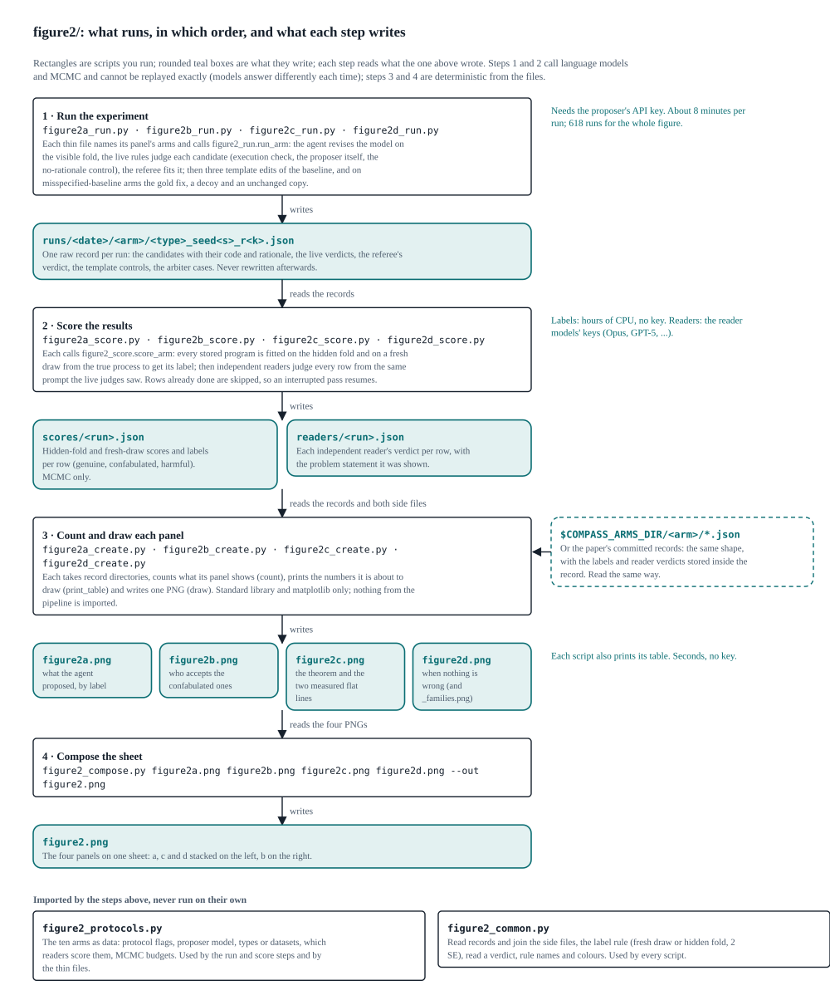

# Figure 2, one script per panel



Each script takes record directories (`$COMPASS_ARMS_DIR/<arm>/`, one JSON file per pipeline
run; `COMPASS_ARMS_DIR` is the `arms/` directory of the unpacked archive of the benchmark
records, see `figures/README.md`), counts what the panel shows, prints the numbers it is about to
draw, and writes one PNG. Every script lists its options in its docstring and prints the same
text with `--help`; the per-panel run and score scripts also list their arms, one line each
(condition, proposer model, number of runs, readers). They share only `figure2_common.py`
(reading records, the label rule, verdicts, rule names and colours) and import nothing from
the pipeline. No API key, seconds to run. The commands run from the `figures/` directory; the
scripts are run as files and reach `figure2/`, `figure3/` and `bench/` through `figures/`.

```bash
cd figures
A="$COMPASS_ARMS_DIR/e5_anthropic $COMPASS_ARMS_DIR/e1_anthropic $COMPASS_ARMS_DIR/e1_anthropic_realdata_x2 $COMPASS_ARMS_DIR/e5_haiku $COMPASS_ARMS_DIR/e1_haiku $COMPASS_ARMS_DIR/e5_gpt $COMPASS_ARMS_DIR/e1_gpt $COMPASS_ARMS_DIR/e1_gpt_realdata_x2 $COMPASS_ARMS_DIR/e5_gemini_flash $COMPASS_ARMS_DIR/e1_gemini_flash"
python figure2/figure2a_create.py $A --out out/figure2a.png          # what the agent proposed, by label
python figure2/figure2b_create.py $A --out out/figure2b.png          # who accepts the confabulated ones
python figure2/figure2c_create.py $COMPASS_ARMS_DIR/e1_anthropic --out out/figure2c.png   # the theorem + two measured lines
python figure2/figure2d_create.py $COMPASS_ARMS_DIR/e5_anthropic --out out/figure2d.png   # when nothing is wrong
python figure2/figure2d_create.py $COMPASS_ARMS_DIR/e5_{anthropic,haiku,gpt,gemini_flash} --out out/figure2d_families.png
python figure2/figure2_compose.py out/figure2{a,b,c,d}.png --out out/figure2.png
```

Give `--out` a `.pdf` name instead of `.png` and every script writes a vector file with editable
text (TrueType fonts); `figure2_compose.py` then lays the four PDFs out on one PDF page, so
`out/figure2.pdf` opens in Illustrator with every label and mark still editable.

What a number means:
- **Label** (`figure2_common.label_of`): the fresh-draw label for a synthetic record (150 new
  points from the true process), the hidden-fold label for real data; a hidden
  "confabulated" on a fold under 10 points is "underpowered"; a failed score is "unavailable".
  Thresholds: genuine if Δ > 2 SE, harmful if Δ < −2 SE, confabulated otherwise.
- **2a** counts the agent's own revisions (pipeline candidates) per arm by label; bars are grouped
  by experiment under a plain-words title (nothing is wrong / a fix exists / real datasets) and
  labelled by proposer model.
- **2b** keeps rows whose label is confabulated or harmful and reports accepted / judged per
  rule; a row the rule gave no verdict on is not judged. Dot = agent's revisions, hollow
  square = template controls, hollow triangle = arbiter cases (misspecified arms only).
- **2c** simulates the referee's S gate on the conjugate normal pair (reps 4000, seed 0) and
  draws the execution check and self-evaluation as flat lines at their measured acceptance of
  all candidates in the arm given.
- **2d** counts runs: a rule replaced the correct model when it accepted any candidate of the
  run; the referee's decision is the run's `validation_passed`.

`tests/figures/test_figure2.py` renders every panel and checks these counts on record fixtures
and on the committed arms (when `COMPASS_ARMS_DIR` is set); `tests/figures/test_figure2_pipeline.py`
exercises every run and score step with stubbed models.

## Re-running the experiments: run, then score, then create

Arm names in this directory read `<baseline>_<proposer>`: `correct-baseline` (the run starts from
the correct model; nothing is wrong), `misspecified-baseline` (a fix exists) or `real-data` (seven
textbook datasets, three hidden splits, double MCMC budget), then the proposer model. The paper's
committed records keep their older short names; `figure2_protocols.py` records the committed
directory of every arm (`describe()` prints it, and the `--help` of every run and score script
lists it per arm):

| Arm | Committed records | Paper's code |
|---|---|---|
| `correct-baseline_sonnet-4.6` | `$COMPASS_ARMS_DIR/e5_anthropic` | E5, Sonnet 4.6 |
| `misspecified-baseline_sonnet-4.6` | `$COMPASS_ARMS_DIR/e1_anthropic` | E1, Sonnet 4.6 |
| `real-data_sonnet-4.6` | `$COMPASS_ARMS_DIR/e1_anthropic_realdata_x2` | real data, Sonnet 4.6 |
| `correct-baseline_haiku-4.5`, `misspecified-baseline_haiku-4.5` | `e5_haiku`, `e1_haiku` | Haiku 4.5 |
| `correct-baseline_gpt-5`, `misspecified-baseline_gpt-5`, `real-data_gpt-5` | `e5_gpt`, `e1_gpt`, `e1_gpt_realdata_x2` | GPT-5 |
| `correct-baseline_gemini-3.8-flash`, `misspecified-baseline_gemini-3.8-flash` | `e5_gemini_flash`, `e1_gemini_flash` | Gemini 3.8 Flash |

Each panel also has a `_run.py` and a `_score.py`. They are thin: `figure2a_run.py` names the
arms panel a needs (`ARMS`) and calls `figure2_run.run_arm` for each; `figure2a_score.py` calls
`figure2_score.score_arm`. Panels a, b and d share arms, and a run whose record exists is
skipped, so running one panel's script after another repeats nothing. `figure2_protocols.py`
is the table of the ten arms (protocol flags, proposer model, types or datasets, readers), plus
one more that the same engine runs for Figure 4: `real-data-default-budget_sonnet-4.6` (the
seven datasets at one hidden split and the default MCMC budget). Every record the engine
writes carries a `cost` block (tokens and seconds per stage and per rule, MCMC seconds per
stage) that Figure 4 reads.

The run step needs the proposer's API key and the score step the readers' keys; export them or
put them in `figures/.env`, which `figure2_run.py` and `figure2_score.py` load (an exported
variable wins). `COMPASS_CACHE_DIR` names the MCMC trace cache the referee, the labels and the
arbiter fits share (default `figures/.test_cache`); `COMPASS_DATA_DIR` names the directory of
the vendored textbook datasets the real-data arms read (the `datasets/` directory of the
archive; the default is the research layout). `--out-root` must lie outside the committed
records: `figures/bench/arms` is refused.

```bash
python figure2/figure2a_run.py   --out-root runs/2026-11 --dry-run      # lists the 618 runs, calls nothing
python figure2/figure2a_run.py   --out-root runs/2026-11 --arm correct-baseline_haiku-4.5   # one arm, 72 runs (proposer key)
python figure2/figure2a_score.py --out-root runs/2026-11 --arm correct-baseline_haiku-4.5   # labels (MCMC), then readers (keys)
python figure2/figure2a_create.py runs/2026-11/correct-baseline_haiku-4.5 --out out/figure2a_rerun.png
```

What each step writes under `runs/2026-11/<arm>/`:
- `<type>_seed<s>[_s<split>]_r<k>.json` from the run: the raw record (the agent's candidates
  with code and rationale, the live verdicts of the execution check, the proposer and the
  no-rationale control, the referee's in-run verdict, the template controls, the arbiter cases
  on misspecified baselines). Never rewritten.
- `scores/<run>.json` from the score step: hidden-fold and fresh-draw scores per row, keyed by
  candidate iteration or row name.
- `readers/<run>.json`: each independent reader's verdict per row, with the statement it was shown.
The create scripts join the side files onto the rows when they load a directory; the committed
arms under `$COMPASS_ARMS_DIR` keep these fields inline, and both forms read the same.

Cost of a full re-run: 618 records, about $300-400 of proposer and judge calls and 25-40 hours of
CPU with four arms in parallel shells (synthetic about 8 minutes per record, real data about 14),
plus about $70 for the reader passes. `tests/figures/test_figure2_pipeline.py` exercises every
step with stubbed models.
