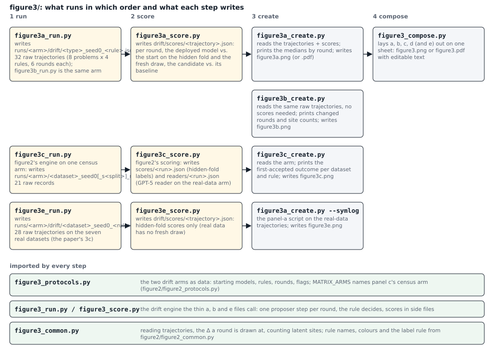

# Figure 3, one script per panel



Figure 3 asks what happens when an acceptance rule is left in charge for several rounds, when
nothing is wrong with the starting model (top row: eight synthetic problems started from their
correct model) and when a fix exists (bottom row: seven real datasets started from their textbook
model, under the drift protocol and under the single-run protocol of Figure 2). The cost figure
in `figure4/` is a supplementary figure. The script names keep the letters they had when the
layout was first drawn; the table below maps the paper's panels to them. Record directories are
`$COMPASS_ARMS_DIR/<arm>`, where `COMPASS_ARMS_DIR` is the `arms/` directory of the unpacked
archive of the benchmark records (see `figures/README.md`):

| Paper panel | Script | Records |
|---|---|---|
| 3a (nothing is wrong, drift) | `figure3a_create.py` | `$COMPASS_ARMS_DIR/e2_anthropic/drift` |
| 3b (why it drifts) | `figure3b_create.py` | same |
| 3c (a fix exists, drift on real data) | `figure3a_create.py --symlog` (run/score: `figure3e_*.py`) | `$COMPASS_ARMS_DIR/e2_anthropic_real/drift` |
| 3d (a fix exists, single run) | `figure3c_create.py` (run/score: `figure3c_*.py`) | `$COMPASS_ARMS_DIR/e1_anthropic_realdata_x2` |

Each `create` script takes record directories, counts what its panel shows, prints the numbers it
is about to draw, and writes one PNG (or a PDF with editable text when `--out` ends in `.pdf`). Every script
lists its options in its docstring and prints the same text with `--help`; the per-panel run and
score scripts also list their arms, one line each. The drawing scripts share only
`figure3_common.py` (reading trajectories, the Δ a round is drawn at, counting latent sample
sites) and, through it, `figure2/figure2_common.py` (the label rule, verdicts, rule names and
colours, so the three figures read one rule). They import nothing from the pipeline. No API key,
seconds to run. The commands run from the `figures/` directory; the scripts are run as files
and reach `figure2/`, `figure3/` and `bench/` through `figures/`.

```bash
cd figures
python figure3/figure3a_create.py $COMPASS_ARMS_DIR/e2_anthropic/drift --out out/fig3a.png                 # a: drift from correct models
python figure3/figure3b_create.py $COMPASS_ARMS_DIR/e2_anthropic/drift --out out/fig3b.png                 # b: why they drift
python figure3/figure3a_create.py $COMPASS_ARMS_DIR/e2_anthropic_real/drift --out out/fig3c.png --symlog   # c: drift on real data
python figure3/figure3c_create.py $COMPASS_ARMS_DIR/e1_anthropic_realdata_x2 --out out/fig3d.png           # d: single run on the same datasets
python figure3/figure3_compose.py out/fig3{a,b,c,d}.png --out out/fig3.png \
    --row-titles "When nothing is wrong: eight synthetic problems, each started from its correct model" \
                 "When a fix exists: seven real datasets, each started from its textbook model"

# the same with .pdf names gives vector panels and a one-page PDF whose text stays editable;
# the output names follow the paper's panel letters, the script names do not (table above)
```

What a number means:
- **Trajectory** (`figure3_common.load_trajectories`): one JSON file `<type>_seed<s>_<rule>.json`
  under an arm's `drift/` directory: one starting model, one acceptance rule, six rounds. Each
  round holds the candidate the agent proposed, the rule's verdict, the model deployed after the
  round, and the held-out scores of that model against the starting one.
- **Δ of a round** (`figure3_common.round_delta`): the log predictive density of the deployed
  model minus the starting model's, on the fresh draw for synthetic data and on the hidden fold
  for real data; a round whose score is unavailable is left out, never drawn as zero.
- **3a** draws every trajectory thin, the median per rule thick and the interquartile range as a
  band; the legend carries the final median. **3e** (the paper's 3c) is the same script with
  `--symlog` on the real-data trajectories (a +1,200-nat fix and ±1-nat wandering on one axis).
- **3b** counts, per rule and round, the trajectories whose deployed model changed, and the mean
  number of latent sample sites (`numpyro.sample` calls without `obs=`) in the deployed model;
  round 0 is the starting model. It needs no held-out score.
- **3c** (the paper's 3d) takes the first candidate each rule accepted in a run and reports its
  hidden-fold label; a dataset's cell is the majority over its three runs (k/n when they
  disagree, ties to the worse outcome). Folds under 10 points cannot label a candidate: those
  cells read "accepted, fold too small" and the dataset carries †. The right margin gives the
  referee's deployments and the median hidden-fold Δ of what it deployed.

`tests/figures/test_figure3.py` renders every panel and the sheet and checks these counts on
record fixtures and on the committed arms (when `COMPASS_ARMS_DIR` is set);
`tests/figures/test_figure3_pipeline.py` exercises every run and score step with stubbed models.

## Re-running the experiments: run, then score, then create

Two kinds of experiment feed the figure. Panels a, b and e are **drift** experiments: from one
starting model, the agent proposes one revision per round, one rule decides whether it replaces
the model, and the accepted revision is the model the next round starts from. Panel c is a
**census** experiment, the Figure 2 protocol on real datasets, run by `figure2/figure2_run.py`.

| Arm (this directory) | Committed records | What it is |
|---|---|---|
| `drift_correct-baseline_sonnet-4.6` | `$COMPASS_ARMS_DIR/e2_anthropic/drift` | 8 synthetic problems, starting from the correct model; 4 rules x 6 rounds (panels a, b) |
| `drift_real-data_sonnet-4.6` | `$COMPASS_ARMS_DIR/e2_anthropic_real/drift` | 7 real datasets, starting from the textbook model, double MCMC budget (panel e) |
| `real-data_sonnet-4.6` | `$COMPASS_ARMS_DIR/e1_anthropic_realdata_x2` | Figure 2's real-data arm: 7 datasets x 3 hidden splits (panel c) |

The drift arms are the table `figure3_protocols.ARM_PROTOCOLS`; the census arm lives in
`figure2/figure2_protocols.py` and `figure3_protocols.MATRIX_ARMS` names it. Each panel has a
thin `_run.py` and `_score.py` that name their arms (`ARMS`) and call the engine:
`figure3_run.run_arm` and `figure3_score.score_arm` for the drift panels,
`figure2_run.run_arm` and `figure2_score.score_arm` for panel c. Panel b shares panel a's arm and
needs no score step, so `figure3b_run.py` has no `_score.py` counterpart.

The run step needs the proposer's API key (and, on the real-data arms, the Semantic Scholar key
of the live literature search); export the keys or put them in `figures/.env`, which the engines
load (an exported variable wins). `COMPASS_CACHE_DIR` names the MCMC trace cache (default
`figures/.test_cache`); `COMPASS_DATA_DIR` names the directory of the vendored textbook datasets
(the `datasets/` directory of the archive; the default is the research layout). `--out-root`
must lie outside the committed records: `figures/bench/arms` is refused.

```bash
python figure3/figure3a_run.py   --out-root runs/2026-11 --dry-run                     # lists the 32 trajectories, calls nothing
python figure3/figure3a_run.py   --out-root runs/2026-11 --only heavy_tails            # 4 trajectories x 6 rounds (proposer key)
python figure3/figure3a_score.py --out-root runs/2026-11                               # hidden-fold and fresh-draw scores (MCMC, no key)
python figure3/figure3a_create.py runs/2026-11/drift_correct-baseline_sonnet-4.6/drift --out out/figure3a_rerun.png
python figure3/figure3b_create.py runs/2026-11/drift_correct-baseline_sonnet-4.6/drift --out out/figure3b_rerun.png
python figure3/figure3c_run.py   --out-root runs/2026-11 --dry-run                     # the 21 census runs behind panel c
```

What each step writes under `runs/2026-11/<arm>/`:
- Drift arms: `drift/<type>_seed<s>_<rule>.json` from the run, rewritten after every round (the
  candidate with code and rationale, the rule's verdict, the deployed model, its latent-site
  count, the tokens and seconds of the round); `drift/scores/<trajectory>.json` from the score
  step, keyed by round: `hidden` (deployed model vs. start on the hidden fold), `fresh` (the same
  on a fresh draw, synthetic data only) and `step` (the candidate vs. the model it was proposed
  for). A complete trajectory is skipped and a partial one resumed from its last deployed model.
- Census arms: as in `figure2/README.md`: one raw record per run, `scores/<run>.json` and
  `readers/<run>.json` from the score step.

Inside a drift round, the pipeline runs once with a single iteration. For the referee rule the
real validator runs inside the pipeline and its verdict is the rule; for every other rule a stub
that always passes replaces it, so the pipeline stops after one synthesis and the rule is applied
to the candidate afterwards. The proposer never sees the hidden fold.

Cost of a full re-run: the synthetic drift arm is 192 proposer steps (about 5 minutes and $0.35
each at Sonnet prices, about $70 and 16 hours in one shell); the real-data drift arm 168 steps
(about 7 minutes and $0.50 each, about $85); panel c's 21 census runs about $17 and 5 hours.
Run several `--only` prefixes in parallel shells. `tests/figures/test_figure3_pipeline.py`
exercises every step with stubbed models and no MCMC.
