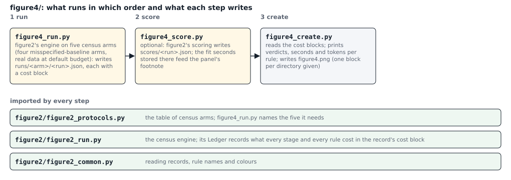

# Figure 4, one script



Figure 4 asks what a verdict costs: for every acceptance rule, the seconds and the tokens per
verdict, read from the `cost` block each record carries. `figure4_create.py` takes record
directories (`$COMPASS_ARMS_DIR/<arm>`, where `COMPASS_ARMS_DIR` is the `arms/` directory of the
unpacked archive of the benchmark records, see `figures/README.md`), counts, prints the numbers
it is about to draw, and writes one PNG (or a PDF with editable text when `--out` ends in
`.pdf`) with one block of bars per directory. It shares `figure2/figure2_common.py` (reading
records, rule names and colours) and imports nothing from the pipeline. No API key, seconds to
run. The commands run from the `figures/` directory; the scripts are run as files and reach
`figure2/` and `bench/` through `figures/`.

```bash
cd figures
A="$COMPASS_ARMS_DIR/e1_anthropic $COMPASS_ARMS_DIR/e1_anthropic_realdata $COMPASS_ARMS_DIR/e1_haiku $COMPASS_ARMS_DIR/e1_gpt $COMPASS_ARMS_DIR/e1_gemini_flash"
python figure4/figure4_create.py $A --out out/figure4.pdf --grouped      # every proposer on one figure, a row each (the paper's version)
python figure4/figure4_create.py $A --out out/figure4_blocks.png         # the same numbers, one block of bars per directory
python figure4/figure4_create.py $COMPASS_ARMS_DIR/e1_anthropic --out out/figure4_sonnet.png   # one arm alone
```

With `--grouped`, each row is one proposer on one kind of data (model name and, in plain words,
synthetic problems or real datasets) and the four rules sit side by side in the rule colours used
in every figure; the referee has no token bar because it spends none.

What a number means:
- **Verdicts** of a reading rule: every program the rule judged in the run, the agent's candidates,
  the three template controls and, on misspecified baselines, the three arbiter cases.
  **Seconds**: the wall time of the judge call, for a language model its API latency.
  **Tokens**: input plus output of that call; the execution check uses none.
- **Referee**: its verdicts are the agent's candidates; its seconds are the MCMC of the validator
  inside the pipeline, over those candidates. Hidden-fold scoring, the arbiter fits and the control
  fits are MCMC that is not a verdict of any rule; the script prints their seconds and does not
  draw them.
- Records without a cost block (the twelve oldest Sonnet records) are skipped and counted.

`tests/figures/test_figure4.py` checks these numbers on record fixtures with known cost blocks
and on the committed arms (when `COMPASS_ARMS_DIR` is set), and renders one arm, several arms
and the grouped sheet.

## Re-running the experiments: run, then score, then create

The records behind Figure 4 are census records (the Figure 2 protocol), so the run and score
steps are `figure2/figure2_run.py` and `figure2/figure2_score.py`; `figure4_run.py` and
`figure4_score.py` name the five arms and call them. Four of the arms are Figure 2's
misspecified-baseline arms, and a run whose record exists under `--out-root` is skipped, so
running this after Figure 2's scripts repeats nothing.

| Arm (this directory) | Committed records | What it is |
|---|---|---|
| `misspecified-baseline_sonnet-4.6` | `$COMPASS_ARMS_DIR/e1_anthropic` | Figure 2's E1 arm, Sonnet 4.6 (60 of 72 records carry a cost block) |
| `misspecified-baseline_haiku-4.5` | `$COMPASS_ARMS_DIR/e1_haiku` | the same protocol, Haiku 4.5 |
| `misspecified-baseline_gpt-5` | `$COMPASS_ARMS_DIR/e1_gpt` | the same protocol, GPT-5 |
| `misspecified-baseline_gemini-3.8-flash` | `$COMPASS_ARMS_DIR/e1_gemini_flash` | the same protocol, Gemini 3.8 Flash |
| `real-data-default-budget_sonnet-4.6` | `$COMPASS_ARMS_DIR/e1_anthropic_realdata` | 7 real datasets, one hidden split, the default MCMC budget |

The run step needs the proposer's API key (and, on the real-data arm, the Semantic Scholar key of
the live literature search); export the keys or put them in `figures/.env`, which
`figure2/figure2_run.py` loads (an exported variable wins). `COMPASS_CACHE_DIR` names the MCMC
trace cache (default `figures/.test_cache`); `COMPASS_DATA_DIR` names the directory of the
vendored textbook datasets (the `datasets/` directory of the archive; the default is the
research layout). `--out-root` must lie outside the committed records: `figures/bench/arms` is
refused.

```bash
python figure4/figure4_run.py   --out-root runs/2026-11 --dry-run                                    # lists the 295 runs, calls nothing
python figure4/figure4_run.py   --out-root runs/2026-11 --arm real-data-default-budget_sonnet-4.6    # 7 runs (proposer + literature keys)
python figure4/figure4_score.py --out-root runs/2026-11 --arm real-data-default-budget_sonnet-4.6    # hidden-fold fits; their seconds feed the footnote
python figure4/figure4_create.py runs/2026-11/real-data-default-budget_sonnet-4.6 --out out/figure4_rerun.png
```

Every record `figure2_run.py` writes carries a `cost` block: tokens and seconds per stage
(pipeline, judges, control, arbiter) and per rule (verdicts, wall seconds, tokens), and MCMC seconds
per stage (`Ledger` in `figure2/figure2_run.py`). The score step stores the seconds of every
hidden-fold fit in `scores/<run>.json`, which the panel's footnote sums. A full re-run is 295 runs,
about $0.10 to $0.70 each by proposer (Gemini Flash, Haiku, Sonnet, GPT-5 in that order) and 3 to
12 minutes each.
